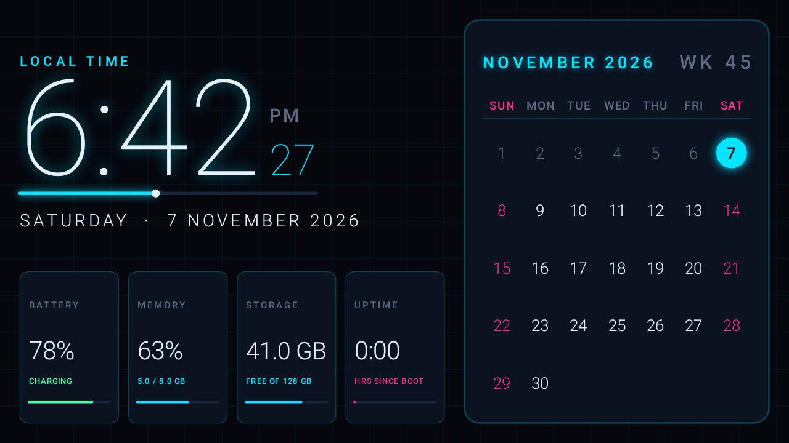
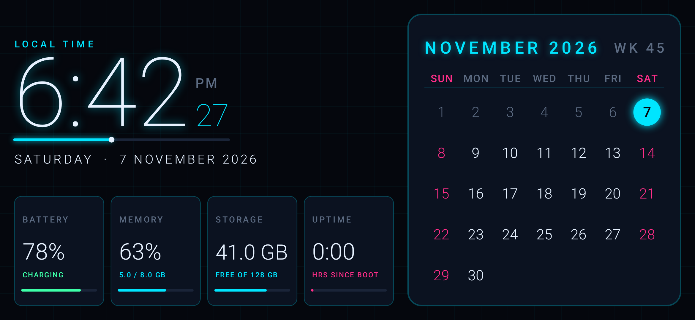

# Infotain Me

A personal Android Auto dashboard for landscape car screens: a glowing digital clock,
a month calendar, and live phone stats (battery, memory, storage, uptime). Written in
plain Java. Sideloaded only, never published to the Play Store.



The same dashboard runs full-screen on the phone too:



## How it works

- **Phone:** open *Infotain Me* from the launcher for a full-screen landscape dashboard.
- **Android Auto:** the app registers as a *navigation* app. Android Auto gives navigation apps a
  blank canvas (normally used for maps), and we draw the dashboard on it. Google wouldn't approve
  this for the Play Store, but that doesn't matter for a sideloaded personal app.

Both screens use the same drawing code in
[`DashboardRenderer.java`](app/src/main/java/com/sapremdonda/infotainme/DashboardRenderer.java).

## Get the APK

Every push to `main` builds the APK on GitHub and publishes it as a release:

1. Open the repo's **Releases** page (on your phone, logged in to GitHub).
2. Under **Assets** in the latest release, download `infotain-me-0.1.N.apk`.
3. Open it and allow installing from unknown apps if asked.

The APK is also attached to each run in the **Actions** tab (as a zip under **Artifacts**).

Every build is signed with the same key (`keystore/debug.keystore`), so newer APKs install over
older ones without uninstalling first.

To build it yourself instead, use Android Studio or `./gradlew assembleDebug`. The APK ends up in
`app/build/outputs/apk/debug/`.

## Show it in Android Auto

Android Auto hides sideloaded apps until you allow them:

1. On the phone, open **Settings → Android Auto** (or the Android Auto app).
2. Scroll down and tap **Version** about 10 times until developer mode turns on.
3. Open the **⋮** menu, then **Developer settings**, and turn on **Unknown sources**.
4. Connect to the car. *Infotain Me* appears in the Android Auto app launcher.

### Test without a car

Use Google's **Desktop Head Unit (DHU)**, a car-screen simulator for your computer:

1. In Android Studio, open **SDK Manager → SDK Tools** and install **Android Auto Desktop Head Unit Emulator**.
2. On the phone, in Android Auto's developer settings (⋮ menu), tap **Start head unit server**.
3. Connect the phone by USB, then run `adb forward tcp:5277 tcp:5277`.
4. Run `desktop-head-unit` from `<sdk>/extras/google/auto/`.

## Project layout

```
app/src/main/java/com/sapremdonda/infotainme/
  MainActivity.java          phone screen (full-screen, landscape)
  DashboardView.java         redraws the phone dashboard every second
  DashboardRenderer.java     draws clock, metrics and calendar (shared)
  DeviceMetrics.java         reads battery, memory and storage
  car/DashboardCarAppService.java   Android Auto entry point
  car/DashboardScreen.java          draws the dashboard on the car's canvas
```
