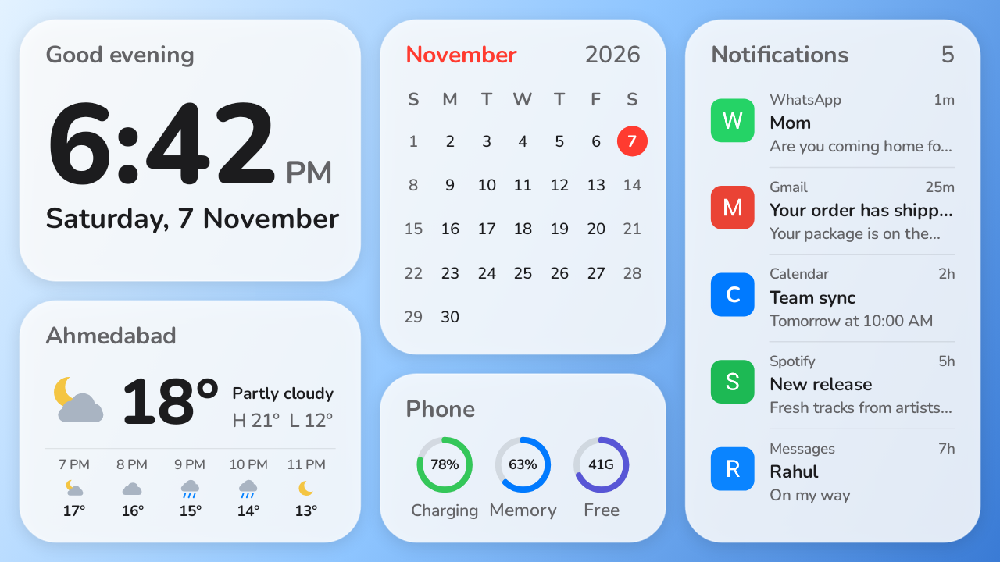
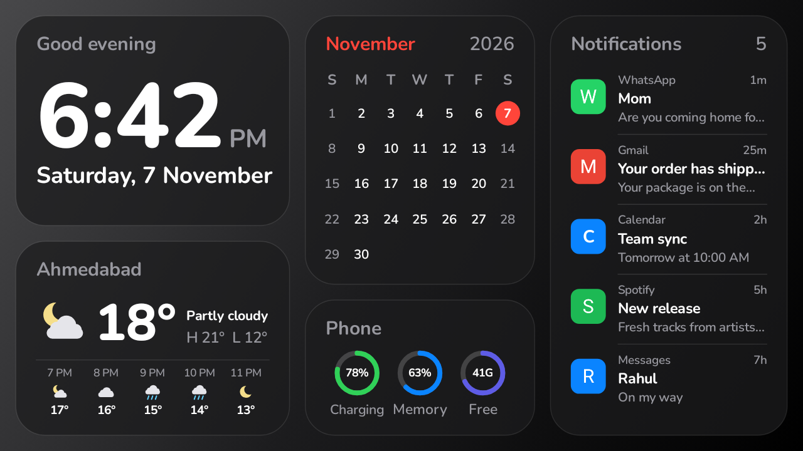
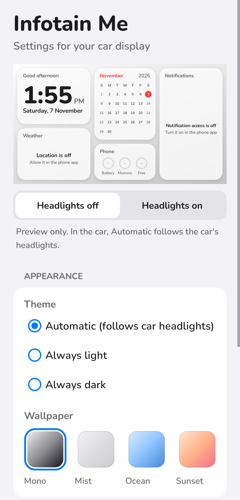

# Infotain Me

A personal Android Auto dashboard. Open it on the car screen to see the time, weather, a
month calendar, your phone's notifications and its battery, memory and storage, on a smooth
gradient wallpaper. Sideloaded only, never published to the Play Store.

| Headlights off | Headlights on |
| --- | --- |
|  |  |

## How it works

- **Car screen:** the dashboard. It switches between light and dark with the car's headlights:
  Android Auto reports night mode from the car, and the dashboard follows it.
  Two buttons on the car screen cycle the wallpaper and the theme.
- **Phone app:** settings for the car screen, with a live preview at the top.

  

| Setting | Options |
| --- | --- |
| Theme | Automatic (car headlights), always light, always dark |
| Wallpaper | Mono (white to black), Mist, Ocean, Sunset, Forest, Lavender, Sand. Each has a day and a night version |
| Temperature | Automatic (from your region), °C, °F |
| Location | Needed for weather |
| Notification access | Needed to show notifications on the car screen |

The app registers with Android Auto as a navigation app, which gives it a blank canvas to draw
on. Google wouldn't allow that on the Play Store, but it's fine for a sideloaded personal app.

## Weather

Weather comes from [Open-Meteo](https://open-meteo.com/) (free, no API key) for the phone's
location, and refreshes every 15 minutes. The last result is saved, so the car screen shows it
straight away. If the phone can't get a fresh location while it's in your pocket, the last known
one is used.

## Fonts

The app uses [Nunito](https://fonts.google.com/specimen/Nunito) (SIL Open Font License), a free
rounded font close to SF Pro Rounded. SF Pro Rounded can't be included because Apple's licence
only allows it on Apple platforms. To use it anyway for yourself, put these files in
`app/src/main/assets/fonts/` and rebuild. The app picks them up automatically:

- `SF-Pro-Rounded-Bold.otf`
- `SF-Pro-Rounded-Semibold.otf`

## Install

Every push to `main` builds the APK and publishes a release:

1. On your phone, open the repo's **Releases** page (logged in to GitHub).
2. Download `infotain-me-0.1.N.apk` from the latest release and open it.
3. Open **Infotain Me** on the phone:
   - Allow location when asked.
   - Tap **Turn on notification access**.

On Android 13 and later, the notification access switch may be greyed out for apps installed
from an APK. Open **App info** for Infotain Me, tap **⋮**, choose **Allow restricted settings**,
then try again. The phone app has a button for this.

### Show it in Android Auto

1. Open **Settings → Android Auto** on the phone.
2. Tap **Version** about 10 times until developer mode turns on.
3. Open the **⋮** menu, then **Developer settings**, and turn on **Unknown sources**.
4. Connect to the car. **Infotain Me** appears in the Android Auto app list.

If the theme doesn't follow the headlights, check that Android Auto's day/night setting
(for maps) is on **Automatic** or **Car**.

### Test without a car

Use Google's **Desktop Head Unit (DHU)**:

1. In Android Studio, open **SDK Manager → SDK Tools** and install **Android Auto Desktop Head Unit Emulator**.
2. In Android Auto's developer settings, tap **Start head unit server**.
3. Connect the phone by USB and run `adb forward tcp:5277 tcp:5277`.
4. Run `desktop-head-unit` from `<sdk>/extras/google/auto/`. Press `n` in the DHU to toggle night mode.

## Build

Use Android Studio, or run `./gradlew assembleDebug`. The APK ends up in
`app/build/outputs/apk/debug/`. Every build is signed with `keystore/debug.keystore`, so new
versions install over old ones.

## Code

```
app/src/main/java/com/sapremdonda/infotainme/
  MainActivity.java                 phone settings screen with live preview
  DashboardView.java                the live preview
  DashboardRenderer.java            draws the dashboard (car and preview)
  DashboardState.java               data for one frame
  Palette.java, Wallpaper.java      light/dark colours and gradient wallpapers
  Fonts.java                        Nunito, or SF Pro Rounded if added
  Weather*.java                     Open-Meteo weather and icons
  NotificationStore.java            current notifications
  DashboardNotificationListener.java   reads notifications (needs notification access)
  DeviceMetrics.java                battery, memory, storage
  Prefs.java                        saved settings
  car/DashboardCarAppService.java   Android Auto entry point
  car/DashboardScreen.java          draws on the car screen; wallpaper/theme buttons
```
